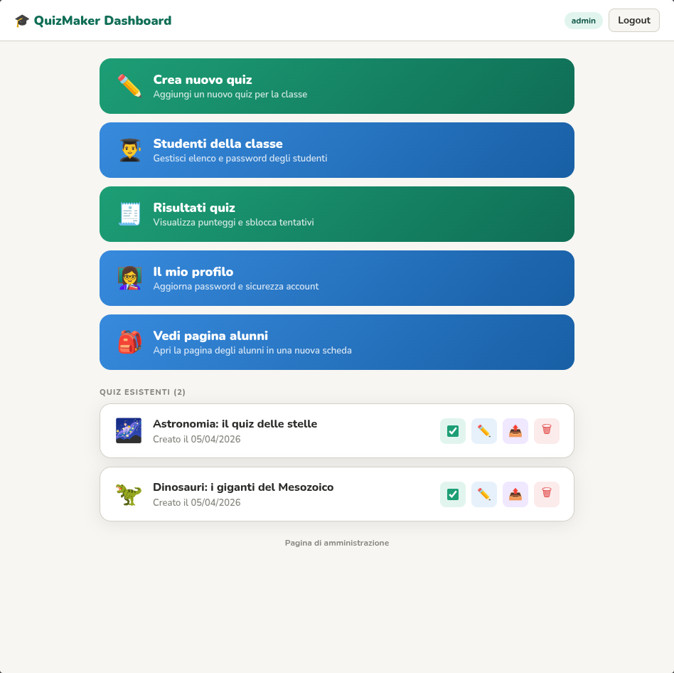

# 🐰 Alice's Simple Quiz Maker

Applicazione web per creare, pubblicare e somministrare quiz scolastici divertenti, con dashboard insegnante, area studente e API REST.



[](https://www.gnu.org/licenses/gpl-3.0)

[](https://sonarcloud.io/summary/new_code?id=saidone75_quizmaker_springboot)
[](https://sonarcloud.io/summary/new_code?id=saidone75_quizmaker_springboot)
[](https://sonarcloud.io/summary/new_code?id=saidone75_quizmaker_springboot)

## 📚 Indice

- [Perché usarlo](#-perché-usarlo)
- [Caratteristiche principali](#-caratteristiche-principali)
- [Stack tecnologico](#-stack-tecnologico)
- [Prerequisiti](#-prerequisiti)
- [Avvio rapido](#-avvio-rapido)
- [Build e test](#-build-e-test)
- [Credenziali iniziali](#-credenziali-iniziali)
- [Profili runtime](#-profili-runtime)
- [Variabili d'ambiente principali](#️-variabili-dambiente-principali)
- [Funzionalità web e API](#-funzionalità-web-e-api)
- [Sicurezza](#️-sicurezza)
- [Database e migration](#️-database-e-migration)
- [Contribuire](#-contribuire)

## 🎯 Perché usarlo

Alice's Simple Quiz Maker è pensato per chi desidera:

- creare quiz in pochi minuti;
- gestire studenti, risultati e tentativi in modo centralizzato;
- usare l'IA (opzionale) per generare domande a partire da un argomento o da allegati;
- usare immagini Wikimedia per quiz più visivi e coinvolgenti;
- condividere quiz tra insegnanti e riutilizzare materiali didattici.

## ✨ Caratteristiche principali

- Software libero e open source con licenza [GPLv3](https://www.gnu.org/licenses/gpl-3.0).
- Accesso **insegnante** con registrazione self-service e dashboard dedicata (`/teacher/...`).
- Gestione **multi-insegnante** con ruoli amministratore/non-amministratore, abilitazione account, reset password.
- Quiz a scelta multipla con **2, 3 o 4 risposte** oppure **vero/falso**.
- Generazione quiz con **OpenAI** (opzionale) e supporto allegati (`.pdf`, `.docx`, testo).
- Ricerca immagini Wikimedia con modalità **advanced** e **simple**, configurabile globalmente o per insegnante.
- Condivisione quiz verso più insegnanti.
- Gestione risultati con analytics e sblocco tentativi singolo studente o massivo.
- Badge per risultati, percorso e costanza, con premi a tema personalizzabili per ogni quiz.
- Raccolta personale dei badge per ogni studente, consultabile anche dal suo insegnante.
- Architettura Spring con migrazioni schema DB versionate via Liquibase.
- Backup schedulato database SQLite in produzione con retention configurabile.

## 🧰 Stack tecnologico

- Java **21**
- Spring Boot **4.1.x**
- Spring Security
- Thymeleaf
- JPA/Hibernate + Liquibase
- H2 (dev/docker) e SQLite (prod)
- Jetty (embedded server)
- DJL (Deep Java Library) + Hugging Face Tokenizers
- Motore locale PyTorch CPU (nessun servizio esterno richiesto per ricerca semantica)

## ✅ Prerequisiti

Per avvio locale:

- JDK 21
- Maven 3.9+

Per avvio Docker:

- Docker
- Docker Compose

## 🚀 Avvio rapido

### 1) Locale (profilo `dev`)

```bash
mvn spring-boot:run
```

Con profilo esplicito:

```bash
mvn spring-boot:run -Dspring-boot.run.profiles=dev
```

Script alternativi:

- Avvio locale: `run.sh` (Linux/macOS) oppure `run.bat` (Windows)
- Avvio Docker: `quizmaker.sh` (Linux/macOS) oppure `quizmaker.bat` (Windows)

### 2) Docker (profilo `docker`)

```bash
docker compose -f docker/docker-compose.yml up --build
```

### Link utili in locale

- App: http://localhost:8080
- Login insegnante: http://localhost:8080/teacher/login
- Registrazione insegnante: http://localhost:8080/teacher/register
- Console H2 (dev): http://localhost:8080/h2-console
- JDBC URL H2: `jdbc:h2:mem:quizmakerdb`
- User H2: `sa`
- Password H2: *(vuota)*

## 🏗️ Build e test

### Build

```bash
mvn clean package
```

Script alternativi:

- Build locale: `build.sh` (Linux/macOS) oppure `build.bat` (Windows)
- Build Docker: `build-docker.sh` (Linux/macOS) oppure `build-docker.bat` (Windows)

### Test

```bash
mvn test
```

### Smoke test end-to-end

Per validare rapidamente il flusso completo (teacher login, creazione studente, creazione quiz, pubblicazione, login studente e submit):

```bash
bb smoke
```

Variabili utili:

- `BASE_URL` (default `http://localhost:8080`)
- `ADMIN_USERNAME` (default `admin`)
- `ADMIN_PASSWORD` (default `changeme`)
- `SPRING_PROFILE` (default `dev`)
- `START_APP=0` per verificare un'applicazione già avviata; altrimenti il test avvia Maven e arresta l'app al termine.
- `DISABLE_TURNSTILE` (default `1`, applicato solo all'app avviata dal test)

Richiede Babashka, `curl` e, per l'avvio automatico, Maven e Java 21.
Il test usa sessioni separate per insegnante e studente, verifica la presenza del quiz pubblicato,
il punteggio e il blocco dopo la consegna, e rimuove il quiz e lo studente creati anche in caso di errore.
Per un'app già avviata, impostare credenziali valide: non vengono registrati nuovi insegnanti.

## 🔐 Credenziali iniziali

L'app crea un utente amministratore di default via configurazione:

| Username | Password   |
|----------|------------|
| `admin`  | `changeme` |

⚠️ In produzione cambia subito la password.

Variabili d'ambiente correlate:

```bash
export ADMIN_USERNAME=admin
export ADMIN_PASSWORD='$2a$12$...'
```

> `ADMIN_PASSWORD` può essere una password in chiaro o un hash bcrypt (anche con prefisso `{bcrypt}`).

## 🎭 Profili runtime

### `dev`

- DB H2 in-memory
- Console H2 attiva
- Turnstile attivo di default con chiavi test

### `prod`

- DB SQLite (`jdbc:sqlite:./data/quizmaker.db` di default)
- Cookie sessione con `Secure=true` e `SameSite=Strict`
- Backup DB abilitato di default

Esempio avvio produzione:

```bash
export PROD_SQLITE_DB_URL=jdbc:sqlite:/opt/quizmaker/data/quizmaker.db
export ADMIN_USERNAME=admin
export ADMIN_PASSWORD='$2a$12$...'

java -jar target/quizmaker-*.jar --spring.profiles.active=prod
```

Quando aggiorni lo schema del database, avvia con `LIQUIBASE_ENABLED=true`
(nel profilo `prod` Liquibase è disabilitato di default).

### `docker`

- DB H2 in-memory
- Profilo dedicato per container (`SPRING_PROFILES_ACTIVE=docker`)

## ⚙️ Variabili d'ambiente principali

| Variabile                            | Default                                           | Descrizione                                   |
|--------------------------------------|---------------------------------------------------|-----------------------------------------------|
| `ADMIN_USERNAME`                     | `admin`                                           | Username amministratore iniziale              |
| `ADMIN_PASSWORD`                     | `changeme`                                        | Password amministratore iniziale              |
| `PROD_SQLITE_DB_URL`                 | `jdbc:sqlite:./data/quizmaker.db`                 | Path DB SQLite in produzione                  |
| `OPENAI_API_KEY`                     | vuota                                             | API key OpenAI                                |
| `OPENAI_MODEL`                       | `gpt-6-luna`                                    | Modello per generazione quiz                  |
| `AI_EMBEDDING_MODEL_URL`             | `djl://.../all-MiniLM-L6-v2` | Modello locale per embedding                  |
| `AI_GENERATION_MAX_QUESTIONS`        | `20`                                              | Numero massimo domande generate               |
| `AI_GENERATION_MAX_ATTACHMENT_CHARS` | `60000`                                           | Max caratteri estratti da allegato (lettura interrotta al limite)            |
| `AI_EXTRACTION_MAX_PDF_PAGES` | `2000` | Pagine PDF massime da elaborare durante l’estrazione |
| `AI_EXTRACTION_MAX_DOCX_XML_BYTES` | `67108864` (64 MB) | XML DOCX decompresso massimo letto; immagini e altri allegati interni esclusi |
| `AI_GENERATION_MAX_ATTEMPTS`         | `2`                                               | Tentativi massimi di generazione/validazione  |
| `AI_IMAGE_SEARCH_TIMEOUT` | `5m` | Tempo massimo complessivo per le immagini di un quiz; immagini mancanti omesse |
| `UPLOAD_DIRECTORY`                   | `./upload`                                        | Directory file upload immagini quiz           |
| `TURNSTILE_ENABLED`                  | `false` (`true` in dev)                           | Abilita CAPTCHA Turnstile                     |
| `TURNSTILE_SITE_KEY`                 | vuota (o test key in dev)                         | Site key Turnstile                            |
| `TURNSTILE_SECRET_KEY`               | vuota (o test key in dev)                         | Secret key Turnstile                          |
| `TURNSTILE_VERIFY_URL`               | endpoint Cloudflare                               | URL verifica Turnstile                        |
| `DB_BACKUP_ENABLED`                  | `false` (`true` in prod)                          | Abilita job backup SQLite                     |
| `DB_BACKUP_CRON`                     | `0 0 2 * * *`                                     | Pianificazione backup                         |
| `DB_BACKUP_DIRECTORY`                | `./backups`                                       | Directory output backup                       |
| `DB_BACKUP_RETENTION_COUNT`          | `30`                                              | Numero backup mantenuti                       |
| `IMAGE_CLEANUP_ENABLED`              | `true`                                            | Abilita job pulizia immagini non referenziate |
| `IMAGE_CLEANUP_CRON`                 | `0 0 3 * * *`                                     | Pianificazione pulizia immagini               |
| `SESSION_COOKIE_SECURE`              | `true` (prod)                                     | Cookie di sessione solo HTTPS                 |

## 🌐 Funzionalità web e API

### Pagine web principali

| URL                                     | Accesso                       | Descrizione                                    |
|-----------------------------------------|-------------------------------|------------------------------------------------|
| `/`                                     | Pubblico / sessione studente  | Login studente + pagina quiz                   |
| `/discover`                               | Pubblico                      | Presentazione delle funzionalità e domande frequenti |
| `/teacher/login`                        | Pubblico                      | Login insegnante                               |
| `/teacher/register`                     | Pubblico                      | Registrazione insegnante                       |
| `/teacher`                              | Insegnante                    | Dashboard quiz                                 |
| `/teacher/students`                     | Insegnante                    | Gestione studenti                              |
| `/student/badges`                       | Studente                      | Raccolta personale dei badge                   |
| `/teacher/students/{studentId}/badges`   | Insegnante                   | Badge di uno studente della propria classe     |
| `/teacher/results`                      | Insegnante                    | Risultati + analytics + sblocco quiz           |
| `/teacher/logs`                         | Amministratore                | Visualizzazione log applicativi                |
| `/teacher/profile`                      | Insegnante                    | Cambio password personale                      |
| `/teacher/profile/theme`                | Insegnante                    | Salvataggio preferenza tema (POST)             |
| `/teacher/profile/image-upload`         | Insegnante                    | Abilitazione upload immagini (POST)            |
| `/teacher/profile/image-search-mode`    | Insegnante                    | Salvataggio modalità ricerca immagini (POST)   |
| `/teacher/quiz/new`                     | Insegnante                    | Editor nuovo quiz                              |
| `/teacher/quiz/{id}/edit`               | Insegnante                    | Editor modifica quiz                           |
| `/teacher/system`                       | Amministratore                | Pannello sistema                               |
| `/teacher/system/teachers`              | Amministratore                | Gestione insegnanti (ruoli, AI, stato)         |
| `/teacher/system/teachers/{id}/approve` | Amministratore                | Approva registrazione insegnante (POST)        |
| `/teacher/system/teachers/approve-all`  | Amministratore                | Approva tutte le registrazioni pendenti (POST) |
| `/teacher/about`                        | Amministratore                | Info build/runtime                             |

### Documentazione API

Consulta [API.md](API.md) per gli endpoint REST di quiz, badge, studenti e log.

## 🛡️ Sicurezza

- CSRF con cookie token (eccetto H2 console).
- Login insegnante con blocco temporaneo dopo troppi tentativi falliti.
- Login studente protetto da rate-limit su IP e keyword.
- Registrazione insegnante rate-limited con integrazione Turnstile (se abilitato).
- Ruoli applicativi: `ROLE_STUDENT`, `ROLE_TEACHER`, `ROLE_ADMIN`.

## 🗃️ Database e migration

Le migration Liquibase sono in `src/main/resources/db/changelog/`.

Quando modifichi lo schema:

1. crea un nuovo file XML incrementale;
2. includilo in `db.changelog-master.xml`.

## 🤝 Contribuire

Consulta [CONTRIBUTING.md](CONTRIBUTING.md).

## 📜 Licenza

Copyright (c) 2026 Miss Alice & Saidone

Distribuito sotto GNU General Public License v3.0. Vedi [LICENSE](LICENSE).
